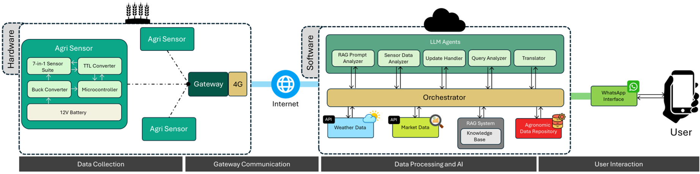
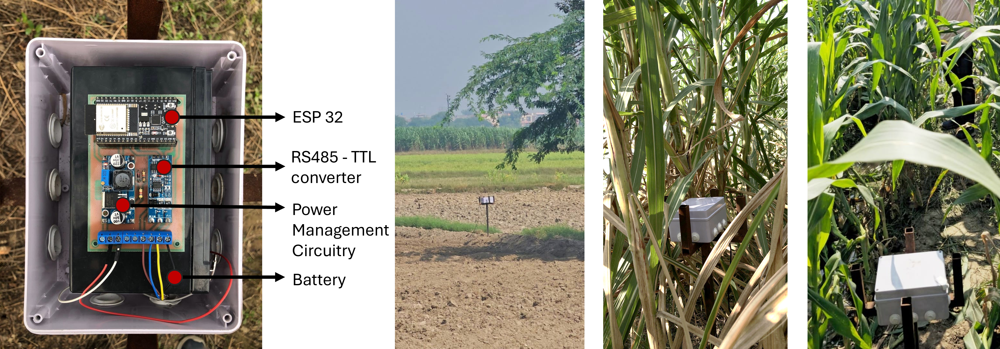
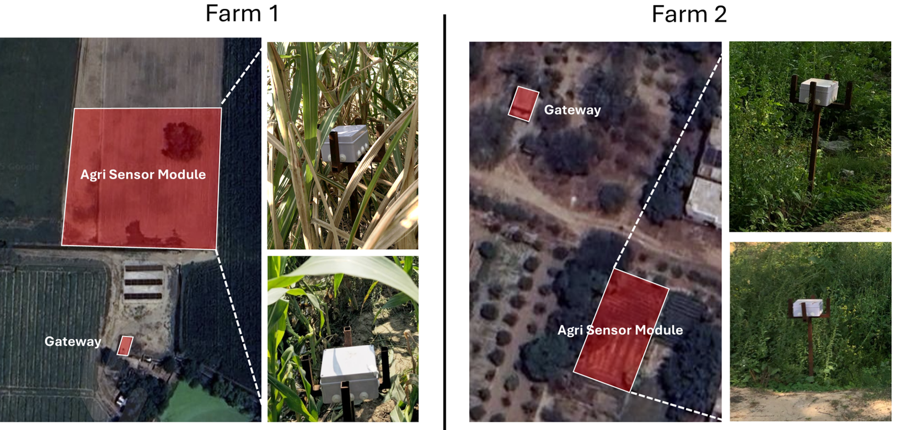
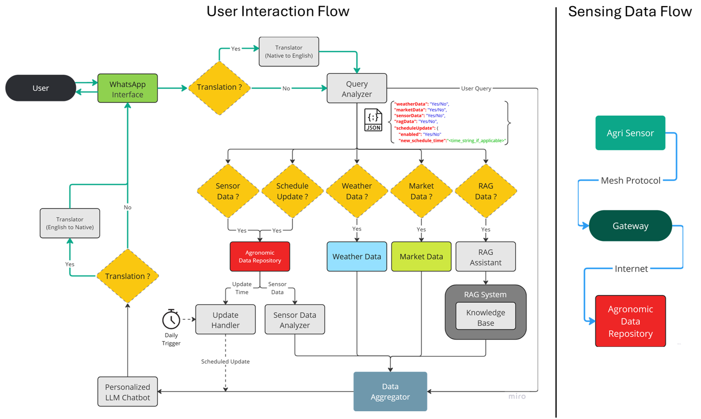
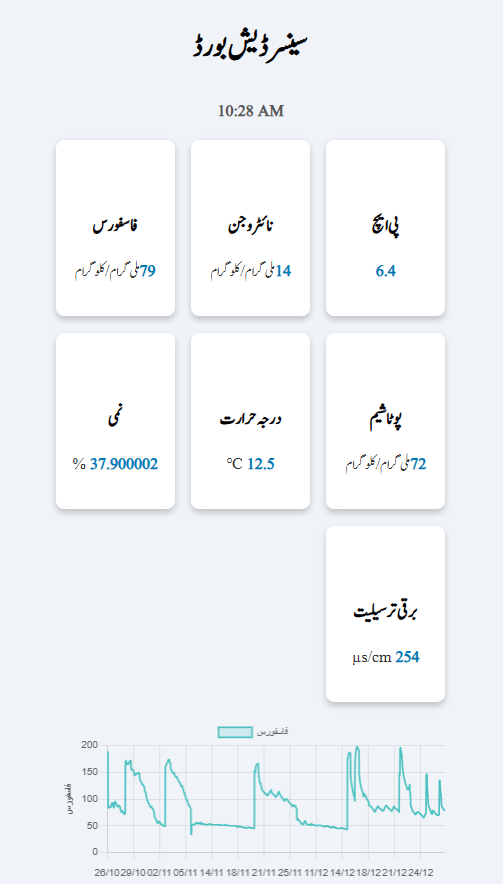
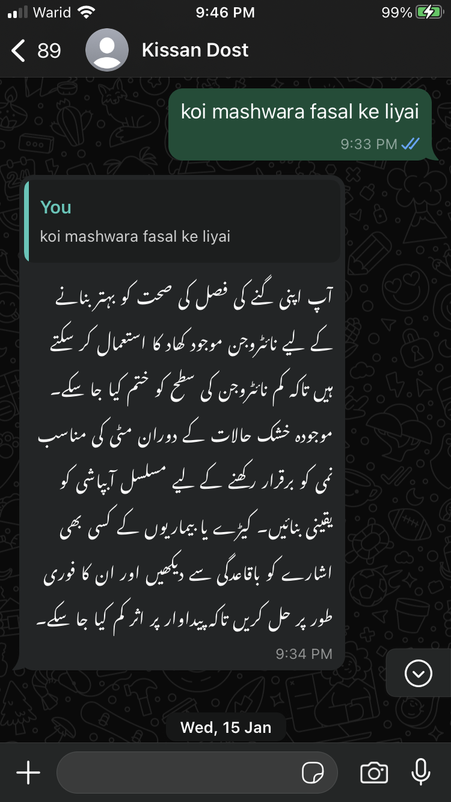

# 🌾 Kissan-Dost: Simplifying IoT Adoption through Conversational AI Framework for Precision Agriculture in Developing Regions

**“Kissan-Dost”** (meaning *Farmer’s Friend*) is a field-validated, end-to-end **IoT + LLM-based conversational system** designed to bridge the gap between smart farming technologies and **low-literate, low-resource smallholder farmers**. It enables actionable agricultural insights through a WhatsApp-based chatbot that speaks the user’s local language—supported by real-time sensor data, weather forecasts, market prices and RAG (retrieval-augmented generation) techniques.

---

## Key Highlights

- **Multilingual** chatbot interface (Urdu, Punjabi, Sindhi) for farmers
- **Voice + Text** over WhatsApp using OpenAI Assistants API
- **Real-time IoT data** from custom field-deployed sensor modules
- **Retrieval-Augmented Generation (RAG)** for crop-specific advisories
- **Low-power sensing gateway** + 4G/ESP-NOW
- Validated over **two 45-day deployments** in Punjab, Pakistan

---

## Research Motivation

Despite IoT’s potential in agriculture, adoption in developing regions is hindered by:

- Infrastructural gaps
- Low literacy rates
- Technological complexity

Kissan-Dost addresses this gap by localizing **LLM-powered agriculture advisory** into familiar communication platforms like WhatsApp, and grounding responses in **real-time sensor data** and regionally tailored agronomic knowledge.

---

## System Architecture



Kissan-Dost is composed of:

- **Data Collection**: Soil sensors (pH, NPK, moisture, EC, temperature)
- **Wireless Gateway**: ESP32 + LTE backhaul
- **Cloud Orchestration**: LLM agents for query analysis, translation, updates and response synthesis
- **Knowledge Sources**: Real-time weather, AMIS market prices, curated agronomic docs
- **LLM Interface**: Delivered via WhatsApp using OpenAI's Assistants API

---

## Hardware Deployment





The IoT hardware stack includes:

- ESP32-powered sensor module with a **7-in-1 RS485 sensor suite** (pH, EC, NPK, Temp, Moisture)
- Custom-designed PCB with:
  - TTL converter for RS485
  - Buck converter for regulated 5V output
  - 12V rechargeable battery
- **Sleep-mode logic** for low power operation
- Field-ready **IP65 enclosures** with mounts for crop-level deployment

> 📁 Arduino source code and circuit diagrams are included in [`arduino_scripts/`](./arduino_scripts/) for replication or extension.

These modules were deployed on two test sites (sugarcane and spinach farms), each with an independent sensing + connectivity pipeline.

---

## User Interaction & Data Flow



The system follows a dual-pipeline:

1. **User Flow**:
   - WhatsApp query → Translate → Analyze → Retrieve Data → Generate Response → Translate → Reply

2. **Sensor Flow**:
   - Sensor → Gateway → Cloud → DB → Analyzer → Advice Trigger

---

## Interaction Examples: Chat + Dashboard

Kissan-Dost offers two primary interfaces, which were evaluated in separate phases:

- The ability to monitor field data via a live **web dashboard**
- The **WhatsApp** based chatbot using voice/text in their local languages

<div align="center">





</div>

## Research Contributions

- **IoT-Integrated Conversational AI**: Seamless fusion of real-time soil sensor data with LLM responses via a multilingual WhatsApp interface.
- **Culturally Grounded Design**: End-to-end localization in voice, script and agricultural content across Urdu, Punjabi, and Sindhi.
- **Systematic Technical Evaluation**:
  - **LLM-as-a-Judge** for assessing response accuracy and helpfulness
  - **RAGAS** to measure factuality and relevance in retrieval-augmented responses
  - **COMETKiwi** and **MetricX-24** for reference-free evaluation of translation fidelity

---

## Field Deployment Outcomes

- **Duration**: Two deployments × 45 days (Sugarcane + Spinach)
- **Sites**: 1 commercial farm, 1 university farm
- **Participants**: 5 farmers (managers + field workers)

### Key Findings
- **Limited dashboard adoption**: Farmers exhibited minimal engagement with visual dashboards due to literacy and usability barriers.
- **High chatbot utility**: The WhatsApp-based interface enabled consistent and trusted interaction, particularly through voice.
- **Increased trust and uptake**: Repeated accurate advisories led to growing reliance on the system for daily decision-making.

---

## 🔧 Module 1: `main_server` — Core Backend for Advisory Orchestration

This module serves as the **central brain** of the Kissan-Dost system. Implemented in FastAPI, it integrates real-time sensor data, weather information, market prices, and policy documents to generate multilingual agricultural advice using OpenAI’s GPT-4o and Retrieval-Augmented Generation (RAG) pipelines.

---

### Setup Instructions

#### 1️⃣ Environment Requirements

Ensure the following are installed:

- Python 3.9+
- PostgreSQL (recommended version 12+)
- FFmpeg (`ffmpeg` command must be globally available)
- OpenAI and [WeatherAPI]((https://www.weatherapi.com/)) credentials

Install Python dependencies:

```bash
cd main_server
pip install -r requirements.txt
```

---

#### 2️⃣ Environment Configuration

Create a `.env` file in `main_server/` with the following content:

```env
# PostgreSQL Configuration
DB_TYPE=postgresql
DB_USER=your_db_user
DB_PASS=your_db_password
DB_HOST=localhost
DB_PORT=5432
DB_NAME=kissanDost

# OpenAI API
OPENAI_API_KEY=your_openai_key

# Weather API
WEATHER_API_KEY=your_weatherapi_key

# WhatsApp Cloud API (optional)
WHATSAPP_BEARER=your_whatsapp_token
```

As the system response is generated independent of WhatsApp, it is not required to run the server. The WhatsApp business API serves only as a message delivery system. You will have to refer to the WhatsApp docs via [Meta's WhatsApp Cloud API](https://developers.facebook.com/docs/whatsapp) for setup.

---

### Database Initialization & Sample Data

#### 3️⃣ Create All Tables

```bash
python -c "import db_schema"
```

Creates the following tables:
- `users`
- `readings`
- `messages`
- `messages_with_translation`
- `app_usage`

#### 4️⃣ Load Sample Sensor Data

Use the provided `readings.csv` and run the following:

```python
import pandas as pd
from db_controllers import addReadingRecord

df = pd.read_csv("readings.csv")
for _, row in df.iterrows():
    addReadingRecord(
        row['pH'], row['nitrogen'], row['phosphorus'], row['potassium'],
        row['temperature'], row['moisture'], row['conductivity'], row['battery'], row['user_id']
    )
```

> Ensure `user_id` values correspond to actual users in the DB. Create test users using `addUser()` if needed.

---

### Document Indexing (RAG)

#### 5️⃣ Add PDFs for Crop Advisories

PDFs used by us have been provided in the `data/` folder.

#### 6️⃣ Build Vector Indexes

Run:

```bash
python index_builder.py
```

> Indexes are later used by GPT-4o to inject factual, policy-grounded information into chatbot responses.

---

### Market Price Scraping

#### 7️⃣ Run Crop Market Scraper

```bash
python market_scraper.py
```

Generates: `cities_crop_prices.json`  
Includes min/max/FQP pricing for key crops across Pakistani cities from [AMIS Pakistan](http://amis.pk).

---

### ▶️ Run the FastAPI Server (locally)

#### 8️⃣ Start the Server

```bash
uvicorn main:app --reload
```

Accessible at:

- API: `http://127.0.0.1:8000`
- Swagger UI: `http://127.0.0.1:8000/docs`

---

### 📡 Key API Endpoints

| Method | Endpoint                     | Function                                   |
|--------|------------------------------|--------------------------------------------|
| `GET`  | `/`                          | Health check                               |
| `POST` | `/transcribeAudio`          | Converts MP3 audio to text via Whisper     |
| `GET`  | `/translatedResponseUser`   | Main pipeline for generating advice        |
| `GET`  | `/getAudioResponse?text=...`| Text-to-speech audio in `.ogg` format      |
| `POST` | `/addReadingRecord`         | Submit sensor data for a specific user     |

---

> This module enables **data-driven, context-aware agricultural advisory** by unifying IoT, NLP, weather, market intelligence and voice feedback into one streamlined API service.

---

## 🔁 Module 2: `daily_updates` — Scheduled Crop Advisories

This component is a lightweight **Node.js/Express-based cron scheduler** that automates daily delivery of personalized agricultural updates to farmers via WhatsApp. It is designed to run independently alongside the FastAPI backend and interfaces directly with the same PostgreSQL database.

---

### Setup Instructions

#### 1️⃣ Install Node Dependencies

```bash
cd daily_updates
npm install
```

#### 2️⃣ Create Environment Configuration

Create a `.env` file in the `daily_updates/` directory:

```env
# PostgreSQL Database (Same as main_server)
DB_NAME=kissanDost
DB_USER=your_db_user
DB_PASS=your_db_password
DB_HOST=localhost
DB_PORT=5432
DB_TYPE=postgres

# OpenAI API
OPENAI_API_KEY=your_openai_key

# WhatsApp Cloud API
WHATSAPP_BEARER=your_whatsapp_token
```

---

### How It Works

At **midnight every day**, the module:

1. Fetches all users and their preferred `update_time` values.
2. Reschedules dynamic cron jobs for each user using `node-cron`.
3. At the assigned time:
   - Retrieves sensor data from the `readings` table.
   - Generates GPT-4o-based summary using OpenAI.
   - Translates and formats the message.
   - Sends it via the WhatsApp API.
   - Logs the message to the database (`messages` table).

---

### ▶️ Run the Server

```bash
node index.js
```

Server will run locally at:

```
http://localhost:3000
```

Logs will indicate scheduling, message generation, and dispatch status.

> ✅ Ensure that the PostgreSQL database used by `main_server` is live and accessible.

---

### Mapping Phone Numbers

To test sending messages, update the `phone_numbers` array in `index.js`:

```js
let phone_numbers = [
  '923xxxxxxxx1',
  '923xxxxxxxx2',
  ...
];
```

> Indexing is based on `user_id - 1`. Confirm the ordering matches actual user IDs.

You must pre-register these numbers with WhatsApp via their developer dashboard to send messages.

---

### Folder Structure

```bash
daily_updates/
├── db.js                # Sequelize DB connection
├── db_controller.js     # Sensor + user data queries
├── db_schema.js         # Sequelize model definitions
├── helpers.js           # GPT logic and WhatsApp integration
├── daily_updates.js     # Advisory message builder
├── index.js             # Express server and scheduler
└── .env                 # Environment configuration
```

---

> This module ensures **timely, automated and hyper-personalized advice delivery**, reducing farmer burden.

---

---

## Module 3: `Agri-Dash` — Real-Time IoT Monitoring Dashboard

This module implements a web-based dashboard using **Express.js + EJS** to render real-time visualizations of field sensor data.

---

### Setup Instructions

#### 1️⃣ Install Node Dependencies

```bash
cd agri-dash
npm install
```

#### 2️⃣ Environment Configuration

Create a `.env` file in `agri-dash/` with your database credentials:

```env
DB_NAME=kissanDost
DB_USER=your_db_user
DB_PASS=your_db_password
DB_HOST=localhost
DB_PORT=5432
```

> ☑️ This DB must already be initialized by the `main_server` setup.

---

### ▶️ Run the Dashboard Server

```bash
node server.js
```

Open your browser at:

```
http://localhost:3000
```

You should see the live Urdu dashboard with sensor summaries and graph overlays.

---

### Project Structure

```bash
agri-dash/
├── server.js           # Express + EJS backend
├── db.js               # PostgreSQL connector
├── db_controller.js    # Sensor query logic
├── refresh.js          # JS for graph updates (AJAX polling)
├── index.ejs           # Main Urdu dashboard template
├── styles.css          # Dashboard styles
├── dash-graph.png      # Screenshot for documentation
└── .env                # Environment variables
```

---

### Route Summary

| Method | Path     | Description             |
|--------|----------|-------------------------|
| `GET`  | `/`      | Live Urdu sensor dashboard |

---

### 📌 Usage Notes

- Sensor values are pulled from the `readings` table using `getLatestReadingByUserID()`.
- Graphs refresh every **30 minutes** using front-end polling.
- Users can click on metrics to visualize historical data trends.

---

## ☁️ Deployment: Hosting the Full Kissan-Dost Ecosystem via Railway

All three components of the Kissan-Dost system were successfully deployed to the cloud using **[Railway](https://railway.app/)**, a developer-friendly platform for managing backend applications with minimal configuration.

### ✅ Why Railway?

- Simple GitHub integration with auto-deploys
- Support for both Python (FastAPI) and Node.js environments
- Built-in PostgreSQL add-on
- Environment variable management
- Free tier sufficient for early research and demos

---

### 📦 Deployment Breakdown

| Module        | Runtime | Railway Service Type       | Notes                                           |
|---------------|---------|----------------------------|--------------------------------------------------|
| `main_server` | Python  | FastAPI (via Uvicorn)      | Exposed API and RAG engine                      |
| `daily_updates` | Node.js | Background worker / cron   | Scheduled daily WhatsApp updates                |
| `agri-dash`   | Node.js | Express web app            | Live dashboard UI in Urdu                       |

---

> 🔗 Refer to the official Railway docs for platform-specific deployment steps: [https://docs.railway.app](https://docs.railway.app)

---

### Environment Notes

All modules used the **same PostgreSQL instance**, with consistent credentials set across `.env` files. Railway's internal networking allows seamless DB access between microservices.

### 🌐 Production URLs

Upon deployment, each module receives its own live URL, such as:

- `main_server`: `https://kissan-main-production.up.railway.app`
- `daily_updates`: (runs silently, no endpoint)
- `agri-dash`: `https://kissan-dash-production.up.railway.app`

---

> Cloud deployment enabled real-time sensor ingestion, advisory generation, and user communication at scale, simulating a production-grade smart farming system for low-resource rural environments.

---

